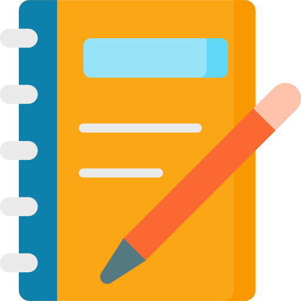

  

# 🟣 Presentación — **App Agenda v2**

Aplicación de escritorio creada para que una modelo webcam lleve control total y claro de sus ingresos, gastos, metas y desempeño quincenal.

---

## 💡 ¿Qué es la App Agenda?

Es una herramienta diseñada para organizar y calcular automáticamente las ganancias del trabajo webcam. La app integra todas las variables que afectan el salario final, permitiendo visualizar de forma clara:

- Lo que se gana por día
- Lo que se descuenta por estudio o gobierno
- Lo que resta de adelantos o préstamos
- Las ganancias reales de cada quincena
- El progreso hacia metas personales

Su principal objetivo es dar **transparencia**, **control** y **orden financiero**.

---

## 🎯 Problema que resuelve

Muchas modelos webcam tienen dificultades para:

- Calcular lo que realmente ganan
- Llevar control de adelantos y préstamos
- Entender cuánto descuentan las páginas y estudios
- Establecer metas y medir resultados
- Saber si están quedando en deuda o cumpliendo su objetivo

La App Agenda automatiza todo ese proceso.

---

## ⭐ Principales Beneficios

- **Control total de ingresos:** todo en un solo lugar.
- **Cálculo automático:** sin hojas de Excel ni cuentas manuales.
- **Metas claras:** permite saber si la modelo va bien o necesita mejorar.
- **Historial quincenal:** fácil seguimiento del rendimiento.
- **Transparencia:** ideal para modelos independientes o modelos que trabajan con estudio.

---

## 🧩 Funcionalidades Clave

### 📌 Registro de páginas donde trabaja la modelo

- Manejo de porcentajes que descuentan
- Configuración de moneda (coins, USD, EUR, GBP)
- Control de descuentos y comisiones

### 📌 Control financiero completo

- Porcentaje del estudio
- Aranceles del gobierno
- Préstamos, adelantos y descuentos
- Interés del 5% si la modelo queda en rojo

### 📌 Registro diario

- Ingresos por página
- Conversión automática de monedas
- Totales diarios y promedios

### 📌 Reportes quincenales

- Comparación con quincenas anteriores
- Promedios y totales
- Ganancia real después de todos los descuentos

---

## 🖥️ Experiencia del Usuario

La aplicación fue diseñada para ser simple y directa:

- Interfaz clara
- Valores fáciles de registrar
- Resúmenes automáticos
- Todo visible en tiempo real

No se necesita conocimiento contable; solo registrar lo trabajado.

---

## 🎯 ¿A quién está dirigida?

- Modelos webcam independientes
- Modelos que trabajan con estudio y quieren claridad en sus pagos
- Estudios que desean registrar ingresos por modelo
- Cualquier persona que necesite control quincenal de ganancias

---

## 🚀 ¿Por qué usar App Agenda?

Porque brinda una visión clara de todo lo que la modelo gana, gasta y debe. Permite entender exactamente
cuánto queda al final y si se están alcanzando las metas.

Es una herramienta pensada para mejorar la organización, la transparencia y la planificación financiera.

---

## 📥 Descarga

- Revisa los archivos [**Errores**](https://github.com/WilsonSanFullStack/app-Agenda/blob/main/Errores.md) y [**Registro**](https://github.com/WilsonSanFullStack/app-Agenda/blob/main/Registro.md) para ver cual es la ultima version
- Puedes descargar la aplicación desde el siguiente enlace:

- [**Descargar App Agenda v2.0.3**](https://drive.google.com/drive/folders/1VlOqk4eX9nhunaooUjTURLyRJ0t2iBw1?usp=sharing)

- [**Descargar App Agenda v2.0.2**](https://drive.google.com/file/d/1_8eAjOktX_knxJF7m5QuQxBViCr9J85h/view?usp=sharing)

---

## 👤 Autor

**Wilson San** — Full Stack Developer

---
